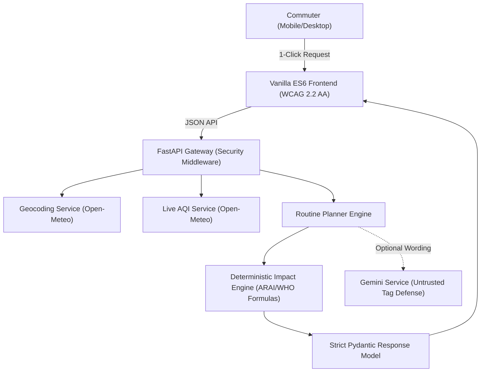

# Urban Air Quality Assistant (Rank 1 Architecture)

[](https://github.com)

A high-performance, GenAI-augmented urban air quality assistant that generates personalized low-emission daily routines, indoor air quality hacks, and sustainable travel alternatives based on real-time location and lifestyle.

All emission savings and exposure reduction metrics are computed by a **pure deterministic mathematical engine** based on ARAI and WHO baselines. **Zero numbers are hallucinated by LLMs.**

---

## 1. Requirement Traceability Matrix (R1 to R7)

| Req | Description | UI Element | Source Code Module | Automated Test File |
|:---|:---|:---|:---|:---|
| **R1** | **Location & Live AQI** | `#city-input`, `#results-container` AQI badge | `services/geocoding_service.py`, `services/aqi_service.py` | `tests/test_aqi_service.py` |
| **R2** | **Lifestyle Profiling** | `#commute-mode-select`, Profile fields | `models/user_profile.py`, `services/routine_planner.py` | `tests/test_routine_planner.py` |
| **R3** | **Daily Routines** | Morning, Afternoon, Evening schedule cards | `services/planner_helpers.py`, `services/routine_planner.py` | `tests/test_routine_planner.py` |
| **R4** | **Indoor Air Hacks** | 4 Category Hacks + Myth-Buster Box | `services/planner_helpers.py` (`generate_indoor_hacks`) | `tests/test_routine_planner.py` |
| **R5** | **Sustainable Alternatives**| Metro, Bus, EV, and Induction replacements | `services/routine_planner.py` (`generate_alternatives`) | `tests/test_routine_planner.py` |
| **R6** | **Direct Impact Math** | Impact Card (CO2 saved, PM reduction %) | `services/impact_engine.py` (ARAI & WHO formulas) | `tests/test_impact_engine.py` |
| **R7** | **Frictionless UI & i18n** | EN/HI Toggle, 320px responsive, <=3 clicks | `public/index.html`, `public/js/render.js`, `public/js/i18n.js`| `tests/js/test_frontend.test.js` |

---

## 2. Architecture & Data Flow



---

## 3. Scientific Impact Formulas

### 1. Commute Emission Reduction ($\Delta \text{CO}_2$)
$$\Delta \text{CO}_2 = (\text{EF}_{\text{current}} - \text{EF}_{\text{alternative}}) \times (D \times 2)$$
- **Emission Baselines (ARAI / CPCB)**:
  - Private Petrol Car: $140\text{ g CO}_2/\text{km}$
  - Petrol Motorcycle: $42\text{ g CO}_2/\text{km}$
  - City Bus: $18\text{ g CO}_2/\text{km}$
  - Metro Rail: $8\text{ g CO}_2/\text{km}$
  - Cycle / Walk: $0\text{ g CO}_2/\text{km}$

### 2. Indoor Exposure Reduction ($\%$)
$$\text{Reduction} = 1 - (1 - E_{\text{vent}}) \times (1 - E_{\text{filter}}) \times (1 - E_{\text{cook}}) \times (1 - E_{\text{clean}})$$
- Vent Timing Peak Avoidance ($E_{\text{vent}}$): $30\%$
- HEPA / DIY Corsi-Rosenthal Filter ($E_{\text{filter}}$): $75\%$
- Range Hood & Cookware Lids ($E_{\text{cook}}$): $60\%$
- Microfiber Wet Mopping ($E_{\text{clean}}$): $35\%$

---

## 4. Quick Start & Testing

```bash
# 1. Clone & Install
git clone https://github.com/urban-air-quality-assistant/urban-air-quality-assistant.git
cd urban-air-quality-assistant
python -m pip install -e .[dev]

# 2. Run Quality Checks & Tests
ruff check .
mypy core models routes services main.py
pytest --cov=. --cov-report=term-missing
node --test tests/js/test_frontend.test.js

# 3. Start Local Server
uvicorn main:app --reload --port 8000
```
Open `http://localhost:8000` in your browser.

---

## 5. Health & Environmental Disclaimer
*This application provides environmental risk reduction guidance and estimated emission impacts for informational purposes. It does not constitute medical advice.*
